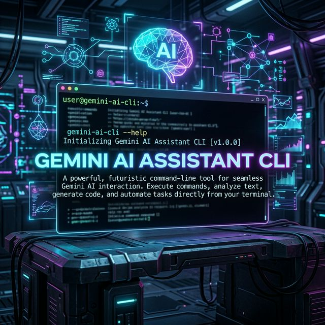

<div align="center">
  
  
  <br/>
  <br/>

  # ✨ Gemini AI Assistant CLI 🚀
  
  **Trợ lý ảo AI chạy siêu mượt ngay trên màn hình Terminal của bạn!**
  
  [](https://www.python.org/)
  [](https://deepmind.google/technologies/gemini/)
  [](https://openai.com/)
  [](LICENSE)
</div>

---

## 🌟 Giới Thiệu
Chào mừng bạn đến với **Gemini AI Assistant CLI**! Đây không chỉ là một công cụ dòng lệnh khô khan, mà là sự hội tụ tinh hoa giữa mô hình **Gemini 3.8 Flash** tối tân từ Google DeepMind và sự tiện lợi, tốc độ tuyệt đối của Terminal. Project sử dụng kiến trúc hoàn toàn tương thích với OpenAI SDK, cho phép bạn dễ dàng tích hợp và mở rộng trong tương lai. 🛸

## 🎯 Tính Năng Nổi Bật

- ⚡ **Tốc độ chớp nhoáng**: Được tối ưu để giao tiếp và phản hồi thời gian thực qua giao diện dòng lệnh.
- 🧠 **Sức mạnh từ Gemini**: Tích hợp model `gemini-3.8-flash` thông minh vượt trội, có thể tư vấn, lập trình, tính toán hoặc trò chuyện vui vẻ cùng bạn.
- 📦 **Quản lý dependencies chuẩn mực**: Sử dụng `uv` build system - nhanh gọn và sạch sẽ.
- 🎨 **Thiết kế tối giản (Minimalist Design)**: Output dễ đọc, tương tác gọn gàng, phù hợp làm việc tập trung cao độ.

---

## 🛠 Hướng Dẫn Cài Đặt

### 1️⃣ Yêu cầu hệ thống
- Python **>= 3.14** (hoặc trình quản lý môi trường phù hợp).
- Tài khoản và API Key của Gemini AI.

### 2️⃣ Khởi tạo
Chạy lệnh sau để clone repo và cài đặt các thành phần cần thiết (thông qua môi trường `uv` hoặc pip thông thường):

```bash
# Clone repo
git clone https://github.com/LoricLocnguyen/agent-harness-build.git
cd agent-harness-build

# Thiết lập khóa API (Linux / macOS)
export GEMINI_API_KEY="your_api_key_here"

# (Hoặc trên Windows PowerShell)
$env:GEMINI_API_KEY="your_api_key_here"
```

### 3️⃣ Bắt đầu sử dụng
Chỉ với cú pháp duy nhất, siêu trợ lý của bạn sẽ thức giấc:

```bash
python v0.py
```

Nhấn `Ctrl+C` bất cứ khi nào bạn muốn thoát vòng lặp tương tác để trở về hệ thực.

---

<div align="center">
  <i>Được xây dựng với 💖 và sức mạnh của <b>Trí Tuệ Nhân Tạo</b>.</i>
</div>
